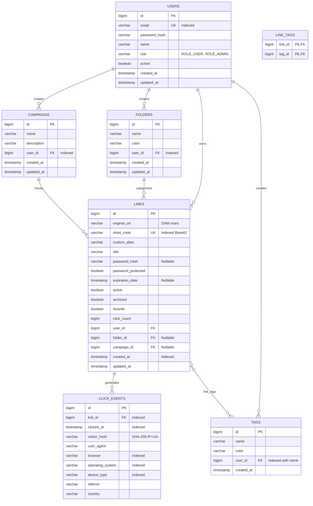

# LinkLytics Database Design & Data Dictionary

## 1. Database Overview
LinkLytics uses **PostgreSQL 16** as its primary persistence engine. The schema is organized into 6 normalized relational entities and 1 join table for tags.

---

## 2. Entity-Relationship (ER) Diagram

---

## 3. Relational Table Specifications

### 3.1 Table: `users`
Stores registered account credentials and authority role.

| Column | Data Type | Nullable | Default | Description |
|---|---|---|---|---|
| `id` | BIGSERIAL | NO | Auto-increment | Primary Key |
| `email` | VARCHAR(150) | NO | - | Unique login email (Unique B-tree index) |
| `password_hash` | VARCHAR(255) | NO | - | BCrypt hashed account password |
| `name` | VARCHAR(100) | NO | - | User display name |
| `role` | VARCHAR(20) | NO | 'ROLE_USER' | Authority level (`ROLE_USER`, `ROLE_ADMIN`) |
| `active` | BOOLEAN | NO | TRUE | Account status for suspension |
| `created_at` | TIMESTAMP | NO | CURRENT_TIMESTAMP | Registration timestamp |
| `updated_at` | TIMESTAMP | NO | CURRENT_TIMESTAMP | Last profile update |

---

### 3.2 Table: `links`
Stores shortened URLs, custom aliases, security properties, and parent folder/campaign relationships.

| Column | Data Type | Nullable | Default | Description |
|---|---|---|---|---|
| `id` | BIGSERIAL | NO | Auto-increment | Primary Key |
| `original_url` | VARCHAR(2048) | NO | - | Full destination web address |
| `short_code` | VARCHAR(50) | NO | - | Unique Base62 code / vanity alias (Unique B-tree index) |
| `custom_alias` | VARCHAR(50) | YES | NULL | User-specified vanity alias |
| `title` | VARCHAR(255) | YES | NULL | Readable link title |
| `password_hash` | VARCHAR(255) | YES | NULL | BCrypt hash for protected links |
| `password_protected`| BOOLEAN | NO | FALSE | Flag indicating password requirement |
| `expiration_date` | TIMESTAMP | YES | NULL | Optional link auto-pause cutoff |
| `active` | BOOLEAN | NO | TRUE | Active status toggle |
| `archived` | BOOLEAN | NO | FALSE | Archived toggle |
| `favorite` | BOOLEAN | NO | FALSE | Starred favorite toggle |
| `click_count` | BIGINT | NO | 0 | Cached total clicks |
| `user_id` | BIGINT | NO | - | Foreign Key -> `users(id)` |
| `folder_id` | BIGINT | YES | NULL | Foreign Key -> `folders(id)` |
| `campaign_id` | BIGINT | YES | NULL | Foreign Key -> `campaigns(id)` |
| `created_at` | TIMESTAMP | NO | CURRENT_TIMESTAMP | Creation timestamp |
| `updated_at` | TIMESTAMP | NO | CURRENT_TIMESTAMP | Modification timestamp |

---

### 3.3 Table: `click_events`
Stores immutable visitor interaction logs generated on each redirect.

| Column | Data Type | Nullable | Default | Description |
|---|---|---|---|---|
| `id` | BIGSERIAL | NO | Auto-increment | Primary Key |
| `link_id` | BIGINT | NO | - | Foreign Key -> `links(id)` |
| `clickedAt` | TIMESTAMP | NO | CURRENT_TIMESTAMP | Event timestamp (Indexed) |
| `visitor_hash` | VARCHAR(64) | YES | NULL | SHA-256 hash of IP + User-Agent |
| `user_agent` | VARCHAR(500) | YES | NULL | Raw user agent string |
| `browser` | VARCHAR(50) | YES | NULL | Detected browser (Chrome, Firefox, Safari, Edge) |
| `operating_system` | VARCHAR(50) | YES | NULL | Detected OS (Windows, macOS, Linux, iOS, Android) |
| `device_type` | VARCHAR(30) | YES | NULL | Device hardware category (Desktop, Mobile, Tablet) |
| `referrer` | VARCHAR(255) | YES | NULL | Referral source domain (Google, Twitter, Direct) |
| `country` | VARCHAR(50) | YES | NULL | Geolocation country indicator |

---

## 4. Indexing Strategy & Query Optimization

| Index Name | Table | Indexed Columns | Justification / Query Benefit |
|---|---|---|---|
| `idx_users_email` | `users` | `email` (UNIQUE) | O(1) user lookup during JWT authentication and login. |
| `idx_links_short_code`| `links` | `short_code` (UNIQUE) | O(1) redirect resolution during `/r/{shortCode}` lookups. |
| `idx_links_user_id` | `links` | `user_id` | Speeds up dashboard queries filtering links by user. |
| `idx_click_events_link_id` | `click_events` | `link_id` | Optimizes aggregations and join queries for single link analytics. |
| `idx_click_events_clicked_at`| `click_events` | `clicked_at` | Accelerates 30-day time-series window queries (`clickedAt >= :since`). |
| `idx_click_events_device` | `click_events` | `device_type` | Speeds up `GROUP BY device_type` aggregations for pie charts. |
