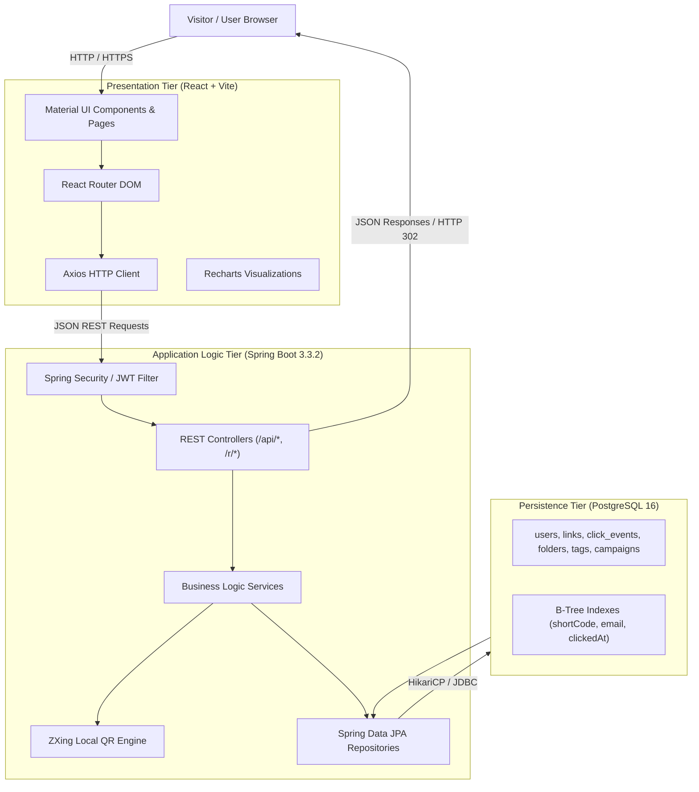
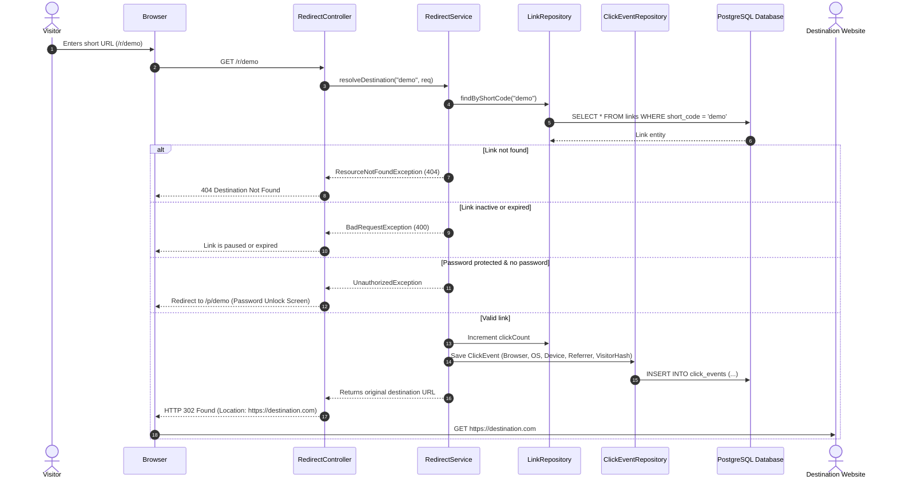
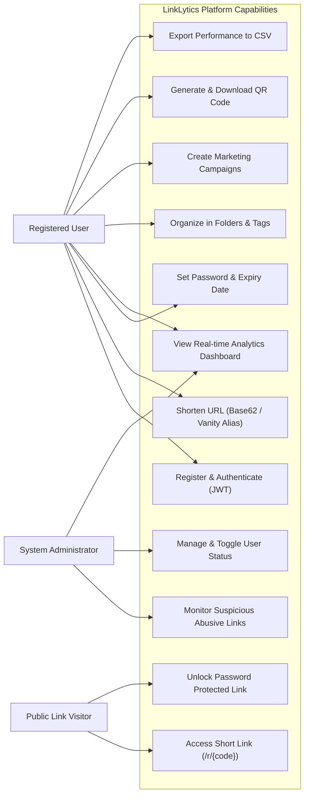
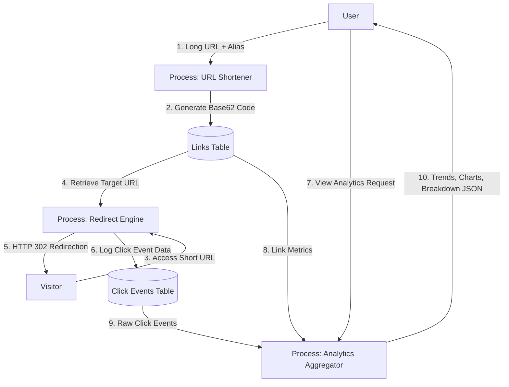

# LinkLytics System Architecture & Design

## 1. High-Level 3-Tier Architecture

LinkLytics employs a decoupled 3-tier enterprise software architecture:
- **Presentation Tier**: React 18 Single Page Application (SPA) powered by Vite, Material UI (MUI v5), and Recharts.
- **Application Logic Tier**: Java 17 Spring Boot 3.3.2 REST API with Spring Security 6, JJWT, and Spring Data JPA.
- **Data Persistence Tier**: PostgreSQL 16 relational database with HikariCP connection pooling and B-tree indexes.



---

## 2. Short Link Redirection & Click Event Pipeline

When a visitor navigates to `https://linklytics.com/r/{shortCode}`:



---

## 3. Use Case Diagram



---

## 4. Data Flow Diagram (DFD Level 1)



---

## 5. Security & Authentication Architecture

1. **Stateless JWT Tokens**:
   - Authentication is issued via `POST /api/auth/login`.
   - The token contains: `subject` (email), `userId`, `role` (`ROLE_USER` or `ROLE_ADMIN`), and standard expiration claims signed with HMAC-SHA256.
   - The React frontend stores the token in `localStorage` and automatically attaches it to Axios headers via interceptors:
     ```
     Authorization: Bearer <jwt_token>
     ```
2. **Spring Security Filter Chain**:
   - `JwtAuthenticationFilter` intercepts each request, validates the signature and timestamp, and populates `SecurityContextHolder`.
   - Cross-Origin Resource Sharing (CORS) is configured to permit designated frontend origins with allowed HTTP methods (`GET`, `POST`, `PUT`, `PATCH`, `DELETE`, `OPTIONS`).
3. **Password Security**:
   - Plaintext passwords are never stored or logged.
   - All passwords (user accounts and protected links) are hashed using `BCryptPasswordEncoder` with standard cost factor 10.
